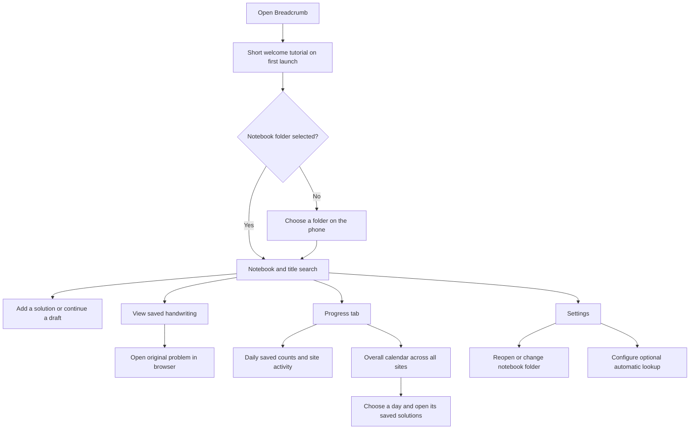
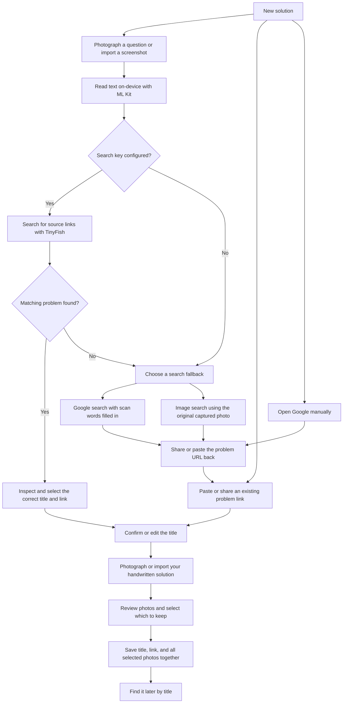

# Breadcrumb

An Android notebook for coding problems and handwritten solutions. Save a problem's title, its original link, and photos of your work. Search the title when you want to revise, view your solution, and open the original question in your browser.

The interface takes visual direction from [Tally](https://composables.com/apps/tally), including cream backgrounds, rounded white panels, dark buttons, and small colour accents. Breadcrumb's UI components are independently implemented.

[Download the Android APK from GitHub Releases](https://github.com/krish007code/Breadcrumb/releases/tag/v0.3.0). This repository is private. Sign in with the owner account or an invited collaborator account to access the release.

## Use case

You solve a LeetCode, Codeforces, or GeeksforGeeks problem on paper. Instead of retyping your explanation or losing the page, take a solution photo and connect it to the problem link. Your saved work stays in an ordinary folder on your phone, which you can copy to a hard disk.

Each saved entry contains an editable title, a source URL, a site category, and one or more solution photos. The question remains available through its source URL.

## App flow



## Interaction flow for adding a solution



## How to use

1. Open Breadcrumb, read the short welcome tutorial, and tap **Continue**. Choose a notebook folder using Android's folder picker. Create a folder such as `Documents/Breadcrumb` if needed.
2. Tap **New solution**.
3. Paste a problem link, share a page from your browser to Breadcrumb, or scan a question using **Scan** or **Screenshot**.
4. If automatic lookup is configured, check the suggested problem and tap **Use this problem**. Otherwise use one of the two Google search buttons and return with a source link.
5. Check the suggested title and edit it if needed. Select a **Site** from the dropdown. The URL suggests a category until you choose one yourself. LeetCode and GeeksforGeeks title suggestions come from the URL or search result. A pasted Codeforces URL suggests the contest number and problem letter, which you can replace with the problem name.
6. Take photos of each page or use **Add photos** to select several from the gallery. Each capture or import appends photos to this solution. Tap **Review and save**, uncheck any photos you want to exclude, and save the selected photos together. Keep at least one photo.
7. Search the notebook with any words from the title. Word order and letter case are ignored. Open an entry and swipe between its photos. Tap a photo to enlarge it, pinch to zoom, and use the arrows to move between enlarged photos. **Open question** opens the original URL.

Leaving the add screen preserves your draft. The notebook's add button becomes **Continue draft** until the entry is saved.

The **Site** dropdown includes LeetCode, Codeforces, GeeksforGeeks, CodeChef, AtCoder, HackerRank, and Other sites. Filter the notebook using **All sites**, or change an existing entry's category in its solution screen. Older entries get their category from the source URL until you select a category yourself.

Long-press a solution card on the Notebook screen to open **Edit** and **Delete**. These actions are also available in the top-right corner of the solution screen. To delete an entry, tap the trash icon or the Delete menu item and confirm **Delete**. This removes the entry's folder and its files from the phone and updates the progress figures. Deletion cannot be undone in the app.

The welcome screen's **See GitHub & star** action opens the repository so you can view or star it on GitHub. You can view the tutorial again from Settings.

### Editing and URL cleanup

Choose **Edit** to change a saved entry's title, problem link, site, or photos. Remove photos from the editor or uncheck them in the final review. New gallery selections and camera captures append to the same solution. The existing saved entry is updated after you confirm the review. If another unfinished draft exists, the app asks before replacing it.

**Clean URL** simplifies supported problem links, removes common tracking parameters and fragments, and preserves functional query parameters on unfamiliar sites. For example, `https://leetcode.com/problems/two-sum/description/?envId=list` becomes `https://leetcode.com/problems/two-sum/`. URL cleanup runs on the phone.

### Install or update from GitHub Mobile

Open this repository's [v0.3.0 release](https://github.com/krish007code/Breadcrumb/releases/tag/v0.3.0), expand **Assets**, and download `Breadcrumb-0.3.0.apk`. Open it using Android's Files app and allow installation from that source when prompted. Install over the existing Breadcrumb app to retain its setup and notebook folder selection.

Release downloads are available to the owner and invited collaborators while the repository is private.

### Google text and photo search

**Search Google with text** opens an ordinary Google search with the recognised words filled in. You can edit the words before launching it.

**Search with this photo** reuses the captured scan and sends this text alongside it using Android's sharing intent.

> Give me the original link for this question. Return the coding problem's title and direct question URL.

**Open with Google** hands the image and text to the Google app when it advertises image-sharing support. Otherwise Android shows compatible apps. The same request is copied to your clipboard. If Google only uses the image, paste the request into **Ask about this image**. Image and text handling varies by the installed Google app and phone.

**Save and open Lens** saves the same scan to a location you choose, copies the link request, and opens Lens in your browser. Select that saved image in Lens and paste the request into **Ask about this image**. When you find the question, use your browser's Share action to send its URL to Breadcrumb, or copy and paste the URL.

Direct photo handoff to Google Lens still requires verification on a physical phone. The app preserves the save-and-select route for phones without a compatible image handler.

### Progress and overall calendar

The second bottom tab is **Progress**.

- **Overview** shows the number of solutions saved over the last 7 or 30 days and a daily bar chart. The site rows show LeetCode, Codeforces, and GeeksforGeeks, with coloured dots for days with saved activity. Other source links are grouped under Other sites when present.
- **Calendar** covers all sites together. It shows the current streak, best streak, active days in the last 30 days, and total saved entries. Tap a date to see that day's solutions.
- Activity is based on the time an entry was saved in Breadcrumb, using the phone's local timezone. Multiple entries on one date count as one active day for streaks. A streak through yesterday remains current while today is still in progress.
- These figures describe your saved notebook entries. Repeated saves create separate entries.

### Automatic source lookup

Open **Settings**, add your own TinyFish Search API key, and tap **Save key**. The key is encrypted using Android Keystore and kept on your phone. It is entered at runtime.

After OCR, the app sends a short extracted text query to TinyFish Search, restricts results to the three supported sites, and offers matching problem links. You confirm the match. API errors and allowance limits leave the manual Google and paste-link routes available.

ML Kit OCR runs on-device using a bundled Latin model. Camera photos remain on the device during automatic source lookup. Choosing a Google photo search hands that image to the selected external app or website.

Check [TinyFish's current Search documentation](https://docs.tinyfish.ai/search-api/reference) and your account allowance before enabling it. The app uses the Search endpoint and makes a single request per lookup.

## Storage and manual backup

Choose a local folder in Android's Files picker. Entries are stored in readable subfolders such as the following.

```text
Breadcrumb/
  Two Sum — a1b2c3d4/
    source.txt
    site.txt
    entry.json
    solution-<id>.jpg
    solution-<another-id>.png
```

`source.txt` contains the title and original URL. Current format version 2 metadata records the entry ID, title, link, site, ordered photo filenames, original save date, and revision number. Newly created entries use `entry.json`. After an edit, the active metadata is stored in a `revision-<number>-<id>.json` file in the same folder.

Edits copy any new photos before committing a complete metadata revision, then clean up superseded metadata and removed photos. The app reads the most recent complete revision and preserves the original entry ID and activity date. Readable `source.txt` and `site.txt` summaries are refreshed after the metadata commit.

Older version 1 metadata containing a single `photo` remains supported. Its optional `site.txt` category is retained when the entry is edited into the new format. Imported PNG, WebP, and HEIC photos retain their respective extensions.

Multiple-photo entries require Breadcrumb 0.3.0 or later.

The short folder suffix keeps identically named entries separate. Editing retains the existing folder. The notebook is reconstructed by reading these folders.

Copy the **entire notebook folder** to your hard disk for backup. To restore, copy it to the phone and select it in Settings. Files in this user-selected folder survive app uninstall. An unfinished draft is stored in the app's private storage and is removed by uninstalling the app.

## Code quality checks

Detekt 1.23.8 and Compose Rules 0.4.23 are configured for Kotlin and Compose analysis. Run the following command to generate the HTML, Markdown, XML, and SARIF reports under `app/build/reports/detekt/`.

```bash
./gradlew :app:detekt
```

The first audit reported 272 findings. After the initial fixes there were 254. The follow-up refactor leaves three Detekt findings and zero Compose findings. Detekt still fails the build while these remain. See the [code quality review](docs/code-quality-review.md) and [Android evaluation guide](docs/android-evaluation.md).

Run the other checks to completion alongside Detekt with:

```bash
./gradlew :app:detekt testDebugUnitTest lintDebug assembleDebug --continue
```

## Build and run

Requires Android 8.0 or later on the phone, JDK 17, and an Android SDK with API 36 and Build Tools 35.0.0 for development.

1. Clone the repository and open its root in Android Studio.
2. Let Gradle sync and install any requested SDK packages.
3. Connect an Android phone with USB debugging enabled, or select an emulator.
4. Run the `app` configuration.

For a command-line build, configure `ANDROID_HOME` or add `sdk.dir` to your untracked `local.properties`, then run the following.

```bash
./gradlew testDebugUnitTest lintDebug assembleDebug
```

The debug APK is written to `app/build/outputs/apk/debug/app-debug.apk`. Install it on a connected development phone with the following command.

```bash
adb install -r app/build/outputs/apk/debug/app-debug.apk
```

## Stack

| Area | Implementation |
| --- | --- |
| Language and UI | Kotlin, Jetpack Compose, Material 3 |
| Camera and screenshots | Android activity-result camera contract and system photo picker |
| OCR | Bundled Google ML Kit Latin text recognition |
| Source suggestions | TinyFish Search over HTTPS with OkHttp |
| Local files | Storage Access Framework and DocumentFile |
| Photo display | Coil with full-screen pinch zoom |
| UI state | ViewModel, SavedStateHandle, and Compose saved state |
| Key storage | AES-GCM with a key in Android Keystore |
| Checks | JUnit tests, Android lint, Detekt, and Compose Rules |

## Verification status

The debug APK builds successfully. All 24 JVM unit tests pass, including legacy single-photo metadata, multiple-photo ordering, edit identity/date preservation, and URL-cleaning checks. Android lint completes with zero errors and 22 warnings covering dependency updates, optional Kotlin idioms, and the newer Android backup configuration format. The project uses pinned dependency versions. Detekt reports three open findings and zero Compose findings.

Physical-device checks for camera capture, document-provider behaviour, browser sharing, and Google Lens handoff are pending. Live TinyFish lookup requires a user-provided key and has not been exercised against a live account.
